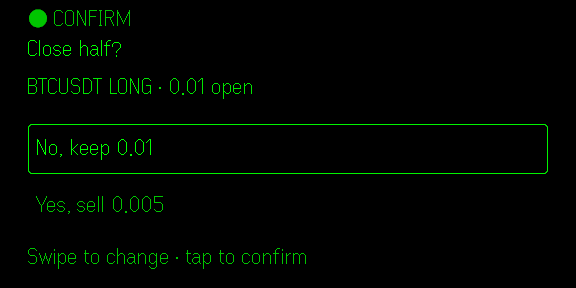

# WickSight

**See the liquidation coming. Get out of it — from your glasses.**

A glanceable liquidation guard for **Even G2**, built for the Even Realities hackathon, **Track 03 — Exchanges & Stocks**.

You look at your position, not your phone. Three lines on the glasses: position, PnL, distance to liquidation. When the tape is trending toward the liquidation line, a fourth line adds **time**: `LIQ IN ~4m at this pace · buffer 4.6%`. Hold the temple and say **"alert 62,000"** or **"close half"**. Every order needs an explicit **No / Yes** confirmation, and the fill comes back with an **after-action receipt**. Testnet only.

```
● BINANCE TESTNET · 20x

BTCUSDT LONG 0.01 · 20x

PnL -0.06 USDT · ROE -0.2%

Liq 58,684.4 · 4.6% away

LIQ IN ~4m at this pace · buffer 4.6%
```

The bottom line is the gesture hint (`Hold: speak · 2x exit`) when the ETA is hidden.

| Glance | Confirm (default No) | Filled |
|---|---|---|
|  |  |  |

*Simulator capture against Binance Futures **testnet**: 0.01 BTCUSDT long, isolated 20x. No keys? The same screens run on a labelled mock position. After a close half the HUD adds the receipt `Liq 58,684 → 55,591 · buffer 4.6% → 9.6%`.*

## Links

- **Demo video (2:59):** [wicksight-final.mp4](https://github.com/artomily/wicksight/releases/download/v1.0.0/wicksight-final.mp4)
- **Live demo:** [deploy the static demo on Vercel](https://vercel.com/new/clone?repository-url=https%3A%2F%2Fgithub.com%2Fartomily%2Fwicksight) — one click, no keys. Vercel builds `demo.html` with `npm run build:demo`; after it finishes, paste the generated `*.vercel.app` URL here. The demo is browser-only, labelled `DEMO · REPLAY`, and makes no exchange calls.

## Static demo (Vercel)

`npm run build:demo` builds only `demo.html` + `src/demo.ts` into `dist-demo/`. It does not bundle the server, `.env`, the API token or the Even Hub SDK. `vercel.json` points Vercel at that build and serves `/` as the demo; leave every environment variable empty. The page runs the recorded 23 Nov 2026 testnet HUD, with buttons and typed commands standing in for voice, and never calls an exchange or the order API.

Preview it locally:

```bash
npm run build:demo
npx vite preview --config vite.demo.config.ts
```

## Why not just a monitor?

A monitor tells you that you are close to liquidation. That is useful until the moment you need to do something about it. WickSight closes the loop on the same screen: the time-to-liquidation is followed by a voice command, a default-No confirmation, a single-use preview, and a reduce-only close-half on Binance Futures testnet. The receipt is the proof: `Liq 58,684 → 55,591 · buffer 4.6% → 9.6%`. No app switch, no phone unlock, no “now what?” at the worst possible moment.

## Why

Trading sessions are exactly the moment a heads-up display earns its place: you are watching two numbers, how far price is from liquidation and how fast it is getting there, while your hands are busy and looking down at a phone costs attention. WickSight is not a trading terminal. It is one screen you can read in a glance and two commands you can say in a second.

## Time to liquidation

The HUD already shows the static distance. WickSight also fits the last three minutes of 1 s mark ticks and turns the slope into a pace:

```
LIQ IN ~4m at this pace · buffer 4.6%
```

- **Only when it is honest.** The line is hidden when price is moving away, when the fit is flat, when the last three minutes are too noisy (R² below 0.2), when there are fewer than 30 ticks, or when the estimate is more than four hours out.
- **No new exchange calls.** The tick ring lives in the server process next to the WebSocket feed; `/api/state` computes the ETA from the cached marks. During a Binance ban the ring drains and the line simply disappears.
- **Read it as an estimate, not a promise.** It is a linear pace from a short window, not a forecast.

## After-action receipt

A close half is only useful if the user can see that it changed the risk. The execute response carries a receipt built from the position before the order and the refreshed position after it:

```
● FILLED
Closed half
Liq 58,684 → 55,591 · buffer 4.6% → 9.6%
Sold 0.005 BTCUSDT @ 61,502.9
Left 0.005
```

The values come from the exchange snapshots, not from the order preview; if Binance returns no liquidation price, the line says `—` instead of inventing one.

## Demo flow (20 seconds)

1. The glasses show the open position, live PnL, liquidation distance, and — when the tape is trending toward the line — `LIQ IN ~4m at this pace`.
2. Hold the temple → **"alert 62,000"** → release. The alert is armed while the app is open.
3. Hold again → **"close half"** → the confirm screen shows **No, keep 0.010** and **Yes, sell 0.005**.
4. Swipe to **Yes**, tap. The order goes to Binance Futures **testnet**; the fill is shown with the after-action receipt (`Liq 58,684 → 55,591 · buffer 4.6% → 9.6%`).
5. Price alert hits → the screen switches to **ALERT HIT** until you tap.

## Who it's for

Active crypto-futures traders who already wear G2 for notifications and navigation, and prop-desk traders who keep one position open through a session. The first version is deliberately single-position: the person who needs this has one trade they care about, not a portfolio to manage from their glasses.

**Why now.** Track 03's own example is this exact flow, and the Even Hub catalogue has messaging, news, AI and navigation apps but no trading app. Testnet-only keeps the first release away from custody and away from financial advice.

**Launch path.**

1. Even Hub catalogue listing — testnet and read-only mainnet.
2. Read-only mainnet: position, PnL and liquidation only; API keys with trade permission disabled.
3. Order writing stays behind an explicit exchange/broker review. WickSight never holds funds.

## Safety model

This is the part that matters for a trading app.

| Risk | How it is handled |
|---|---|
| Mainnet / real funds | **Binance:** the adapter refuses to boot against any host that is not `testnet.binancefuture.com` (exact hostname match, lookalikes rejected). **OKX:** there is no separate demo host — the adapter refuses to construct unless `OKX_DEMO=1` and always sends `x-simulated-trading: 1`. Treat OKX as demo-header-only, not a sandbox guarantee. No live order path is wired. |
| API keys | Only in the server's `.env`. Never sent to the WebView, never logged, never committed (`.gitignore`). |
| Order API access | `/api/orders/*` requires a shared bearer token (`API_TOKEN`) that only the app bundle carries; CORS is an origin allowlist (`CORS_ORIGINS`). An unauthenticated request cannot preview or execute, even on localhost. It stops drive-by pages and bare `curl`; it is not user authentication, so set a random token and HTTPS for any public deployment. |
| Accidental order | Voice only creates a **preview**. Executing requires a second gesture: swipe to **Yes**, then tap. The default selection is **No**. |
| Double execution | The preview ID is single-use, bound to the exact quantity, and expires after 45 s. A replay gets `409 PREVIEW_USED`, an expired one `410 PREVIEW_EXPIRED`, and the position cannot move twice. |
| Stale quantity | The server re-reads the position before sending and refuses an order larger than the open position or below the exchange step size. |
| ETA | A display-only linear fit of the last three minutes of mark ticks. It is hidden when price moves away, when the fit is flat or noisy, and when the estimate is over four hours. It is not a liquidation prediction. |
| Receipt | Built from the cached position before the order and the exchange position after it. A missing liquidation price renders as `—`, never as an invented number. |
| Rate limits | Mark price arrives over WebSocket (zero REST weight). REST is used only for the initial snapshot, orders and a 12 s fallback. On `-1003` / 429 the server stops **all** REST calls until the ban's own resume timestamp, keeps serving the cached position, and the HUD shows `RATE LIMITED`. |
| Auto-trading | There is none. Alerts are display-only; nothing fires an order without a human. |
| Data | One position, read from the user's own exchange account. No analytics, no third-party sharing. |

Alerts only fire **while the app is open** — Even G2 shows one app at a time and cannot push in the background. The UI says so on the alert confirmation screen.

## Architecture

```
Even G2 (or the Even Hub simulator)
└── WebView app — Vite + TypeScript + @evenrealities/even_hub_sdk
    ├── 3-line HUD + ETA hint (576×288), textContainerUpgrade for live values
    ├── push-to-talk: 16 kHz PCM16 from the glasses mic
    └── fetch → WickSight API (whitelisted origin in app.json)
                 │
                 ├── POST /api/voice     PCM → Whisper small.en → intent
                 ├── GET  /api/state     cached position + alert + ETA (no exchange call)
                 ├── POST /api/orders/preview   exact qty + token
                 └── POST /api/orders/execute   single-use token → fill + receipt
                              │
                    Binance Futures TESTNET (default)
                    ├── mark price: WebSocket `<symbol>@markPrice@1s`
                    ├── position/fills: user data stream (listenKey)
                    ├── REST: initial snapshot, orders, 12 s fallback (5 min heartbeat)
                    └── -1003 / 429: all REST paused until the ban ends
                    OKX demo (adapter fallback, 12 s poll)
                    Mock paper position (no keys, labelled "MOCK DATA")
```

The 2-second client poll hits only the local API. The exchange is read over
WebSocket, so the HUD stays live without REST weight; if the socket drops, a
single REST snapshot runs at most every 12 s, and a Binance IP ban stops every
request until its resume timestamp.

The phone-side page in the simulator (and the WebView on real hardware) shows connection state and a text box that exercises the same intent parser — useful when a demo room is too loud.

## Run it

Prerequisites: Node 20+, npm, the Even Hub CLI and simulator.

```bash
npm install -g @evenrealities/evenhub-cli @evenrealities/evenhub-simulator
```

```bash
git clone <your-fork> wicksight && cd wicksight
npm install
cp .env.example .env
```

### 1. Testnet keys (no real money)

1. Open <https://testnet.binancefuture.com> and sign in.
2. Create an API key (Wallet → API Key). Testnet keys only work on testnet.
3. Put them in `.env`:

```dotenv
EXCHANGE=binance
BINANCE_API_KEY=...
BINANCE_API_SECRET=...
SYMBOL=BTCUSDT
API_TOKEN=...      # openssl rand -hex 16 (the WebView gets the same value at build time)
CORS_ORIGINS=http://localhost:5173,http://127.0.0.1:5173
```

4. Verify access without placing an order (uses the same `API_TOKEN`; no token is printed):

```bash
npm run check:live
```

Expected: `mode: binance-testnet`, the current position, and `OK — testnet endpoint reachable and signed request accepted.` If you see `mode: mock`, the keys are not in this `.env` (only `.env.example`) or `EXCHANGE` still forces mock.

`npm run check` is the softer version: it also accepts the mock adapter, for development. If you deploy the API anywhere, set a random `API_TOKEN`, add the app origin to `CORS_ORIGINS`, and put the API behind HTTPS.

### 2. Start it

```bash
npm run dev      # Vite on :5173 + API on :8787 (watch mode, for development)
npm run sim      # second terminal: evenhub-simulator http://localhost:5173
```

For recording, use `npm start` instead: same two servers, but the API runs
without the file watcher, so an editor autosave cannot restart it mid-take.

The glasses canvas should show the position. Hold the simulator's press control to talk (macOS will ask for microphone permission for your terminal — allow it).

### 3. No keys? Mock mode

With no keys, `EXCHANGE=auto` falls back to a deterministic paper position and the HUD clearly says **MOCK DATA**. Every screen and order path works; nothing leaves your machine.

```bash
curl -X POST localhost:8787/api/dev/reset   # put the demo position back
```

While developing, `?demo=confirm`, `?demo=listening` and `?demo=alert` open those screens directly in a dev build (`import.meta.env.DEV` only).

## Voice

Speech-to-text runs **locally** by default: `onnx-community/whisper-small.en` (q8) inside the Node process via `@huggingface/transformers`. No API key, no audio leaves the machine. The model downloads once (~250 MB) and is warmed at boot; a short command transcribes in ~0.7 s. Set `ASR_MODEL=onnx-community/whisper-tiny.en` for a 40 MB model (~0.25 s) if you accept weaker number recognition.

```dotenv
ASR_PROVIDER=local     # or openai
OPENAI_API_KEY=        # only if ASR_PROVIDER=openai
```

Commands understood:

| Say | Result |
|---|---|
| "alert 62,000" / "alert at sixty two thousand" | arms a price alert (above or below, derived from the market) |
| "close half" / "close half of the position" | opens the confirm screen |
| "cancel the alert" | clears it |
| "close all" | refused on purpose — only half is enabled |

`npm run check` shows the exchange path. `POST /api/intent {"text":"..."}` exercises the parser without audio.

## Packaging and deployment (optional)

`npm run pack` produces `out.ehpk` (manifest + built `dist`). To run on real glasses the API needs a public HTTPS origin with CORS enabled; add that origin to the `network` whitelist in `app.json`. Keep the testnet keys on that server, never in the app bundle.

The repo is deliberately **local-first**: judges and the owner can run the whole demo with `npm run dev` and the mock adapter, no keys, no hosting. The API binds to `127.0.0.1` by default; set `HOST=0.0.0.0` only when a phone on the LAN must reach it, and restrict CORS before exposing it publicly.

## Project layout
```
src/
  main.ts        screen state machine, bridge events, feed polling, voice flow
  ui.ts          every page as plain container specs (576×288)
  audio.ts       push-to-talk PCM recorder
  api.ts         typed client for the local API
  hostPanel.ts   phone-side status + parser test box
  demo.ts        browser-only Vercel demo (mock state, no server)
  demo.css       static demo page styles
server/
  index.ts       Fastify routes, CORS, order guards
  exchange/      binance.ts (testnet), okx.ts (demo), mock.ts
  eta.ts         mark-tick ring + time-to-liquidation fit
  receipt.ts     before/after close-half receipt
  asr.ts         local Whisper / optional OpenAI
  intents.ts     deterministic voice intent parser
  store.ts       alert state + single-use order previews
shared/types.ts  the JSON contract both sides use
scripts/check-exchange.ts   setup doctor
demo.html        static demo entry (Vercel)
vite.demo.config.ts         demo-only Vite build
vercel.json     Vercel build/output/rewrite
docs/            demo script + feature requests
```

## Tests

`npm test` runs 50 checks with no network and no keys: intent parsing (spoken numbers, percent phrasing, refusal of "close all"), step-size flooring, alert arming, mark-price recomputation, ban/Retry-After parsing, the non-testnet host guard, the ETA fit (trend toward/away, flat/noisy, too few ticks, past the line, four-hour cap), the after-action receipt (before/after liq, missing liq, buffer fallback), and a stubbed Binance testnet that verifies request signing, the reduce-only order payload and error mapping. Route-level tests cover the order auth, preview → execute → replay (`409`) with receipt, expired (`410`), unknown (`404`), wrong-symbol (`409`), CORS allow/deny, a 429 that flips the adapter to PAUSED with zero follow-up calls, and `/api/state` returning an ETA only on a clean trend.

```bash
npm test
```

## Bench notes

- Display: 576×288, one LVGL font, no size/alignment control. Layout is spacing and brightness, measured at a 27 px line pitch.
- The SDK delivers a single tap as a `sysEvent` with `eventType` 0 omitted (SDK 0.0.16 + simulator 0.9.x). The app handles both that and the documented `textEvent` click.
- No background. The WebSocket feed lives on the server, but the WebView is suspended when the app is not in front; the HUD refreshes from the cache on foreground.
- The simulator is not an emulator; timing, BLE and mic permission differ on hardware.

## Built during the hackathon

Everything in this repo was written during the Even Realities hackathon (23–29 Nov 2026). Pre-existing: the official Even Hub SDK, CLI, simulator and Vite. The Whisper model is a public Hugging Face checkpoint.

Track 03 — Exchanges & Stocks. Binance Futures testnet only; OKX runs in demo-header mode. Not financial advice.

## Docs

- [3-minute demo script](docs/demo-script.md)
- [Remotion demo video (7 replay beats)](video/README.md)
- [Feature requests for Even Realities](docs/feature-requests.md)
